<div align="center">

  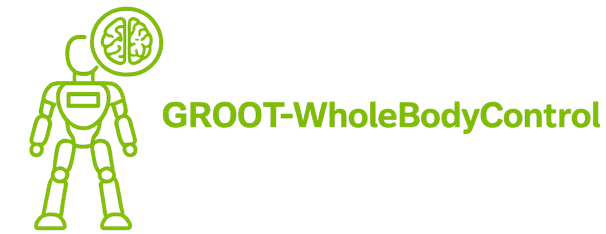

  <!-- --- -->
  
  
</div>

<div align="center">

[](LICENSE)
[](https://github.com/isaac-sim/IsaacLab/releases/tag/v2.3.2)
[](https://nvlabs.github.io/GR00T-WholeBodyControl/)
[](https://nvlabs.github.io/GEAR-SONIC/demo.html)

</div>

---


# GR00T-WholeBodyControl

This is the codebase for the **GR00T Whole-Body Control (WBC)** projects. It hosts model checkpoints and scripts for training, evaluating, and deploying advanced whole-body controllers for humanoid robots. We currently support:

- **Decoupled WBC**: the decoupled controller (RL for lower body, and IK for upper body) used in NVIDIA GR00T [N1.5](https://research.nvidia.com/labs/gear/gr00t-n1_5/) and [N1.6](https://research.nvidia.com/labs/gear/gr00t-n1_6/) models;
- **GEAR-SONIC Series**: our latest iteration of generalist humanoid whole-body controllers (see our [whitepaper](https://nvlabs.github.io/GEAR-SONIC/));
- **MotionBricks**: a real-time latent generative model for interactive motion control in animation and robotics (see the [project page](https://nvlabs.github.io/motionbricks/)).

## News

- **[2026-05-07]** 🤖 **End-to-end VLA workflow on G1** — collect teleop data, fine-tune Isaac-GR00T N1.7, and deploy with SONIC whole-body control. See [Data Collection](https://nvlabs.github.io/GR00T-WholeBodyControl/tutorials/data_collection.html), [VLA Workflow](https://nvlabs.github.io/GR00T-WholeBodyControl/tutorials/vla_workflow.html), and [VLA Inference](https://nvlabs.github.io/GR00T-WholeBodyControl/tutorials/vla_inference.html).
- **[2026-04-27]** 🧩 **MotionBricks preview** — interactive G1 demo, pretrained checkpoints (VQVAE · pose · root), synthetic training code, and motion-representation docs. See [`motionbricks/`](motionbricks/) and the [project page](https://nvlabs.github.io/motionbricks/).
- **[2026-04-14]** 🌐 **[Live web demo](https://nvlabs.github.io/GEAR-SONIC/demo.html)** — try SONIC interactively in your browser. Features [Kimodo](https://github.com/nv-tlabs/kimodo) text-to-motion generation.
- **[2026-04-10]** 🚀 Released **SONIC training code and checkpoint** on [HuggingFace](https://huggingface.co/nvidia/GEAR-SONIC). Train from scratch or finetune. **Additional embodiment support** and **VLA data collection pipeline**. See [Training Guide](https://nvlabs.github.io/GR00T-WholeBodyControl/user_guide/training.html).
- **[2026-03-24]** 🔧 C++ inference stack update: motor error monitoring, TTS alerts, ZMQ protocol v4, idle-mode readaptation. **ZMQ header size changed to 1280 bytes.**
- **[2026-03-16]** 📦 [BONES-SEED](https://huggingface.co/datasets/bones-studio/seed) open-sourced — 142K+ human motions (~288 hours) with G1 MuJoCo trajectories.
- **[2026-02-19]** 🎉 Released GEAR-SONIC: pretrained checkpoints, C++ inference, VR teleoperation, and documentation.
- **[2025-11-12]** 🏁 Initial release with Decoupled WBC for GR00T N1.5 and N1.6.

## Table of Contents

- [News](#news)
- [GEAR-SONIC](#gear-sonic)
- [VR Whole-Body Teleoperation](#vr-whole-body-teleoperation)
- [Kinematic Planner](#kinematic-planner)
- [SONIC Training](#sonic-training)
- [TODOs](#todos)
- [What's Included](#whats-included)
  - [Setup](#setup)
- [Documentation](#documentation)
- [Citation](#citation)
- [License](#license)
- [Support](#support)
- [MotionBricks](#motionbricks)
- [Decoupled WBC](#decoupled-wbc)


## GEAR-SONIC 

<p style="font-size: 1.2em;">
    <a href="https://nvlabs.github.io/GEAR-SONIC/"><strong>Website</strong></a> | 
    <a href="https://huggingface.co/nvidia/GEAR-SONIC"><strong>Model</strong></a> | 
    <a href="https://arxiv.org/abs/2511.07820"><strong>Paper</strong></a> | 
    <a href="https://nvlabs.github.io/GR00T-WholeBodyControl/"><strong>Docs</strong></a>
  </p>

<div align="center">
  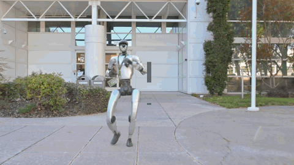
  
</div>

SONIC is a humanoid behavior foundation model that gives robots a core set of motor skills learned from large-scale human motion data. Rather than building separate controllers for predefined motions, SONIC uses motion tracking as a scalable training task, enabling a single unified policy to produce natural, whole-body movement and support a wide range of behaviors — from walking and crawling to teleoperation and multi-modal control. It is designed to generalize beyond the motions it has seen during training and to serve as a foundation for higher-level planning and interaction.

In this repo, we release SONIC's training code, deployment framework, model checkpoints, and teleoperation stack for data collection.


## VR Whole-Body Teleoperation

SONIC supports real-time whole-body teleoperation via PICO VR headset, enabling natural human-to-robot motion transfer for data collection and interactive control.

<div align="center">
<table>
<tr>
<td align="center"><b>Walking</b></td>
<td align="center"><b>Running</b></td>
</tr>
<tr>
<td align="center">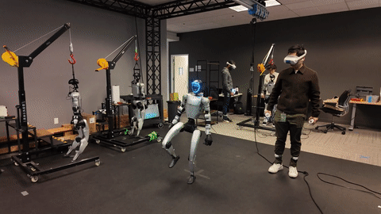</td>
<td align="center">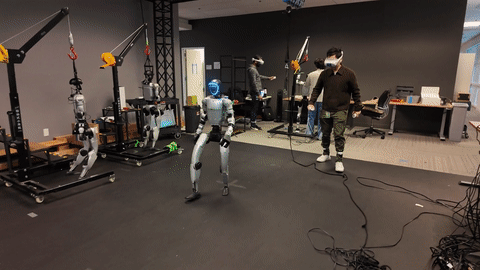</td>
</tr>
<tr>
<td align="center"><b>Sideways Movement</b></td>
<td align="center"><b>Kneeling</b></td>
</tr>
<tr>
<td align="center">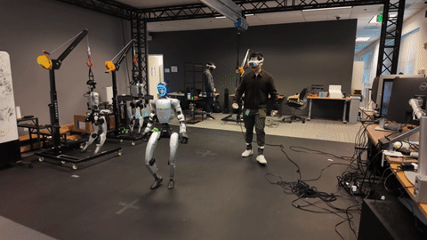</td>
<td align="center">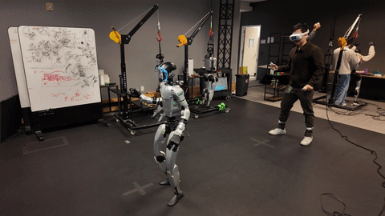</td>
</tr>
<tr>
<td align="center"><b>Getting Up</b></td>
<td align="center"><b>Jumping</b></td>
</tr>
<tr>
<td align="center">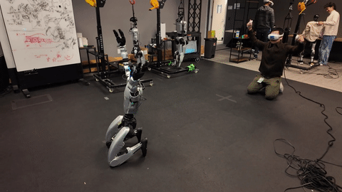</td>
<td align="center">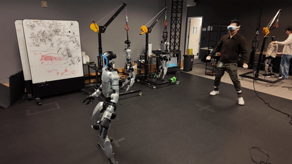</td>
</tr>
<tr>
<td align="center"><b>Bimanual Manipulation</b></td>
<td align="center"><b>Object Hand-off</b></td>
</tr>
<tr>
<td align="center">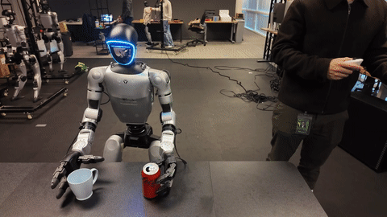</td>
<td align="center">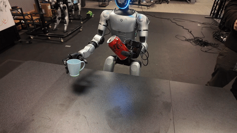</td>
</tr>
</table>
</div>

## Kinematic Planner

SONIC includes a kinematic planner for real-time locomotion generation — choose a movement style, steer with keyboard/gamepad, and adjust speed and height on the fly.

<div align="center">
<table>
<tr>
<td align="center" colspan="2"><b>In-the-Wild Navigation</b></td>
</tr>
<tr>
<td align="center" colspan="2">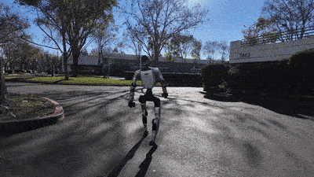</td>
</tr>
<tr>
<td align="center"><b>Run</b></td>
<td align="center"><b>Happy</b></td>
</tr>
<tr>
<td align="center">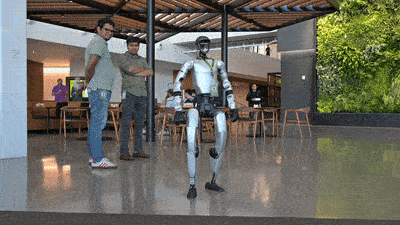</td>
<td align="center">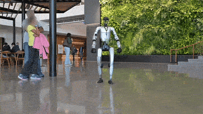</td>
</tr>
<tr>
<td align="center"><b>Stealth</b></td>
<td align="center"><b>Injured</b></td>
</tr>
<tr>
<td align="center">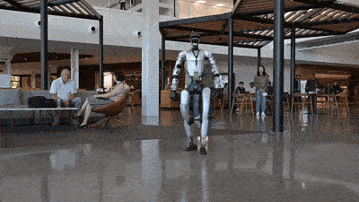</td>
<td align="center">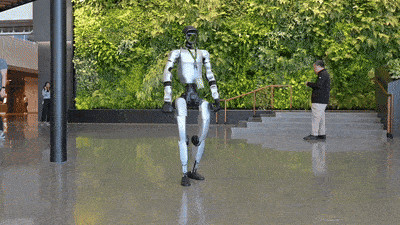</td>
</tr>
<tr>
<td align="center"><b>Kneeling</b></td>
<td align="center"><b>Hand Crawling</b></td>
</tr>
<tr>
<td align="center">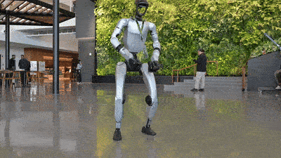</td>
<td align="center">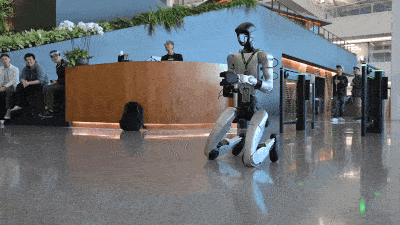</td>
</tr>
<tr>
<td align="center"><b>Elbow Crawling</b></td>
<td align="center"><b>Boxing</b></td>
</tr>
<tr>
<td align="center">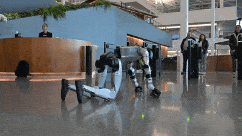</td>
<td align="center">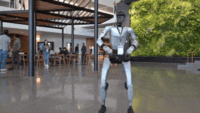</td>
</tr>
</table>
</div>

## SONIC Training

SONIC can be trained from scratch on the [Bones-SEED](https://huggingface.co/datasets/bones-studio/seed)
motion capture dataset (142K+ motions, ~288 hours, Unitree G1 retargeted), or finetuned
from the released checkpoint on [Hugging Face](https://huggingface.co/nvidia/GEAR-SONIC).

### Quick start

```bash
# Install training dependencies (Isaac Lab must be installed separately — see docs)
pip install -e "gear_sonic/[training]"

# Download checkpoint + SMPL data from Hugging Face
pip install huggingface_hub
python download_from_hf.py --training

# Download Bones-SEED G1 CSVs from huggingface.co/datasets/bones-studio/seed, then convert and filter
python gear_sonic/data_process/convert_soma_csv_to_motion_lib.py \
    --input /path/to/bones_seed/g1/csv/ \
    --output data/motion_lib_bones_seed/robot --fps 30 --fps_source 120 --individual --num_workers 16
python gear_sonic/data_process/filter_and_copy_bones_data.py \
    --source data/motion_lib_bones_seed/robot --dest data/motion_lib_bones_seed/robot_filtered

# Finetune from released checkpoint (64+ GPUs recommended)
accelerate launch --num_processes=8 gear_sonic/train_agent_trl.py \
    +exp=manager/universal_token/all_modes/sonic_release \
    +checkpoint=sonic_release/last.pt \
    num_envs=4096 headless=True \
    ++manager_env.commands.motion.motion_lib_cfg.motion_file=data/motion_lib_bones_seed/robot_filtered \
    ++manager_env.commands.motion.motion_lib_cfg.smpl_motion_file=data/smpl_filtered
```

For the full guide including multi-node training, evaluation, ONNX export, and SOMA encoder setup:
📖 [Installation (Training)](https://nvlabs.github.io/GR00T-WholeBodyControl/getting_started/installation_training.html) |
[Training Guide](https://nvlabs.github.io/GR00T-WholeBodyControl/user_guide/training.html)

### H2LoRA training maintenance scripts

The `h2lora` branch includes local maintenance scripts for reproducing the
SONIC G1-to-Unitree-H2 LoRA adaptation experiments.  They are intended for
Isaac Lab training/debug machines and assume the released checkpoint is present
at `sonic_release/last.pt`.

Use the lightweight uv environment for data processing, SwanLab utilities, and
MuJoCo rendering:

```bash
uv venv .venv-h2lora --python 3.10
uv pip install --python .venv-h2lora/bin/python -e "gear_sonic[training]" swanlab imageio-ffmpeg
```

Use Isaac Sim's Python for training and rollout collection:

```bash
export H2LORA_TRAIN_PYTHON=/home/sky/software/isaac-sim/python.sh
```

Key scripts:

- `gear_sonic/data_process/build_h2lora_seed_motion_lib.py` builds paired
  H2 robot and SMPL MotionLib PKLs from `/mnt/data/seed/{h2,smpl-x,soma_uniform}`.
  The current SMPL path uses `soma_uniform/bvh` FK plus name mapping because the
  local `smpl-x/uniform` poses are SOMA-X 77-joint order, not SONIC SMPL24 body
  pose order.  Training recipes use 50 Hz MotionLib data; non-integer 120 Hz to
  50 Hz conversion is done with time-domain interpolation and root-quaternion
  slerp.
- `scripts/build_h2lora_seed5m_schema6_cache.sh` rebuilds the current 5M cache
  in two stages: a uniformly sampled schema6 source MotionLib, then a balanced
  mixed MotionLib used by long training.  It writes to `_schema6` suffixed
  directories by default so old `smplx-fk` diagnostic caches remain untouched.
- `scripts/build_h2lora_balanced_from_motionlib.py` creates a balanced training
  subset from an existing H2LoRA MotionLib without re-running retargeting.  It
  preserves paired robot/SMPL clips, validates schema6/fps/source metadata, and
  can oversample locomotion/dynamic/static buckets with renamed duplicate keys.
- `scripts/run_h2lora_seed5m_balanced_mixed_50k.sh` launches the current long
  H2LoRA run from the released SONIC checkpoint.  By default it uses
  `num_envs=6144`, 50k PPO iterations, DDR MotionLib caching, SwanLab logging,
  GPU utilization/power CSV logging, and an auto-visualization watcher.
- `scripts/run_h2lora_seed5m_from_release.sh` is the smaller release-seed
  launcher.  Set `H2LORA_CHECKPOINT=/path/to/last.pt H2LORA_RESUME=true` to
  resume from an existing run; leave `H2LORA_CHECKPOINT` empty for a fresh LoRA
  load from `sonic_release/last.pt`.
- `scripts/run_h2lora_locomotion_tiny_mixed_encoder.sh` runs a small-data
  overfit/debug recipe for checking whether mixed G1/teleop/SMPL encoder
  sampling can learn before launching large-scale training.
- `scripts/watch_h2lora_checkpoints_visualize.sh` polls a run directory for
  `model_step_*.pt` and exports fixed reference/tracking videos.  It collects
  rollout trajectories with Isaac Sim Python, then renders MP4s with
  `.venv-h2lora`.  The default motion list lives in
  `scripts/h2lora_typical_viz_motions.txt`; the watcher reloads this file before
  every checkpoint so future probes can be changed without stopping training.
- `scripts/visualize_h2lora_ref_tracking.py` is the manual H2LoRA visualization
  entry point.  It supports policy rollout, direct H2 reference-PD playback, and
  replaying external 29D G1 actions through the H2LoRA action bridge.
- `scripts/visualize_g1_release_on_h2adapted_ref.py` runs the released G1 policy
  on an H2 reference after applying the H2-to-G1 semantic adapter.  This isolates
  source policy tracking from H2 robot dynamics.
- `scripts/visualize_g1_release_on_source_ref.py` runs the released G1 policy on
  the original Bones-SEED G1 source CSV reference.  Use this when checking
  whether a motion is already trackable by the source G1 policy before blaming
  the H2 adaptation path.
- `scripts/export_h2lora_deploy_reference.py` converts H2LoRA MotionLib PKLs
  into the CSV format used by `gear_sonic_deploy`.  It keeps the reference
  source as H2 31-DoF physical motion, strips the head, applies the same
  H2-to-G1 semantic alignment used during training, and writes a manifest that
  `deploy.sh --robot h2_lora` now requires.  Do not point H2LoRA deploy at the
  old G1 `reference/example/` directory.
- H2LoRA MuJoCo sim2sim uses the stock H2 MJCF asset at runtime and now follows
  the same operator/state-machine semantics as the G1 sim2sim path.  Start the
  simulator in one terminal, then start deploy in another:

  ```bash
  # Terminal 1, from the repository root.
  .venv-h2lora/bin/python gear_sonic/scripts/run_sim_loop.py --wbc-version h2_lora

  # Terminal 2, from gear_sonic_deploy/.
  ./deploy.sh --robot-profile h2_lora --input-type keyboard sim
  ```

  Unitree ROS commit `aa0f5c68` adds a motor-side H2 closed-loop model with
  knee, ankle-pitch, and differential waist linkages.  Run that model through
  the dedicated profile so the legacy direct-drive ROS profile remains
  available for A/B comparisons:

  ```bash
  # Terminal 1, from the repository root.
  .venv_sim/bin/python gear_sonic/scripts/run_sim_loop.py \
    --wbc-version h2_lora_unitree_ros_loop

  # Terminal 2, from gear_sonic_deploy/.
  ./deploy.sh --robot-profile h2_lora --input-type keyboard --no-planner sim
  ```

  The loop profile publishes the same 31 PR/output-coordinate LowState used by
  deploy.  MuJoCo output-coordinate PD torques are mapped to the official
  motor-side actuators each step with the current equality-constraint
  Jacobian; reset uses the same constraints to project the nominal H2 stand
  onto a feasible closed-loop configuration.

  Download only the released G1 kinematic planner when it is not present:

  ```bash
  .venv_inference/bin/python download_from_hf.py --planner-only
  ```

  The H2LoRA simulation profile loads that planner by default. Use
  `--no-planner` to retain the static-reference-only workflow. Real H2 launches
  keep the planner disabled unless `--planner PATH` is passed explicitly. Press
  `Enter` to enable the planner after the policy enters control. H2 physical
  state is mapped through the target-to-source kinematic map for planner
  initialization. Each generated G1 reference is projected through `Phi+` to H2
  physical space and back through `Phi` to the 29D semantic space used by the
  H2LoRA encoder; policy actions are then mapped through `Phi+` before the 31D
  H2 DDS command is published. Set
  `GEAR_SONIC_H2LORA_PROJECT_PLANNER_REFERENCE=0` only for a direct-reference
  A/B run.
  The planner itself keeps the released G1 nominal root height (`0.788740 m`).
  The current H2LoRA G1 encoder does not consume root Z, so this first planner
  bridge intentionally does not apply an H2 root-height offset.

  The H2LoRA sim config defaults to a 1000 Hz MuJoCo loop; avoid overriding
  `--sim-frequency` unless you are deliberately testing low-level stability.
  Simulation mode passes `--disable-crc-check`, which also skips the real-robot
  `MotionSwitcherClient` release step so MuJoCo startup is not blocked by a
  hardware-only service.
  `deploy.sh` defaults to `sonic_h2lora_release/exported/model_decoder_latest.onnx`
  and `policy/release/observation_config_h2_lora.yaml`; the latter is guarded so
  the 930D proprioception slice stays in the actual IsaacLab `PolicyCfg`
  concatenation order
  `base_ang_vel -> joint_pos -> joint_vel -> last_action -> gravity`.  The
  exported H2LoRA wrapper also overwrites the final 29 actor-observation values
  with the previous raw policy action, so the deploy runtime preserves that
  compatibility quirk exactly.  In the keyboard flow, `y` confirms deployment
  and starts the INIT/default-pose ramp, `]` enters CONTROL and immediately runs
  the policy on the current/held reference frame, `9` in MuJoCo toggles the
  elastic support just like G1, `t/T` starts or pauses reference-frame
  advancement, and `n/p` switches motions.  By default H2LoRA does not write a
  MuJoCo reset file on `t/T` and does not bypass policy with a direct default
  pose after `]`.
- H2LoRA MuJoCo sim2sim defaults to the training/deploy action semantics:
  decoder raw action scale is `1.0`, and the explicit MuJoCo torque PD tracks
  the published `q_target` directly using the gains in LowCmd, matching
  `unitree_mujoco`'s bridge formula.  Do not use the older implicit `0.25`
  residual attenuation or split default-pose PD for normal tracking checks;
  those make the robot look like it is barely responding to the reference.
  `GEAR_SONIC_POLICY_ACTION_SCALE=<value>` remains available for controlled
  decoder-action scale ablations, but the MuJoCo low-level PD path itself is no
  longer overridden by H2-specific debug environment variables.
- H2LoRA deploy speaks official Unitree H2 DDS motor order at the LowCmd/LowState
  boundary (`legs + waist + arms + head`).  The local training/MuJoCo asset keeps
  head before arms, so the Python sim bridge maps DDS order back to local joint
  order internally.  When CSV logs are enabled, `lowcmd_command.csv` and motor
  telemetry (`motor_temperature/error/torque`) are written in DDS motor order;
  `q.csv`/`dq.csv` are reconstructed in local H2 MuJoCo/training order for
  visual inspection, and `action.csv` remains the 29D policy action.
- H2LoRA sim2real uses the same deploy executable and state machine as G1.  The
  Unitree SDK2 H2 low-level examples use the same HG `LowCmd_`/`LowState_`
  topics (`rt/lowcmd`, `rt/lowstate`) plus `rt/secondary_imu`,
  `MotionSwitcherClient`, CRC, `mode_pr`, and returned `mode_machine`; H2LoRA
  therefore keeps the G1 operation flow and only changes the robot profile:

  ```bash
  # From gear_sonic_deploy/.
  ./deploy.sh --robot-profile h2_lora real
  # Or pin a specific robot NIC.
  ./deploy.sh --robot-profile h2_lora enP8p1s0
  ```

  Real mode keeps CRC enabled and runs `MotionSwitcherClient` release like G1.
  Simulation mode is the only mode that passes `--disable-crc-check` and skips
  the hardware release service.  The LowCmd writer publishes all 31 H2 motors at
  500 Hz; the decoder still outputs only the 29 body actions, and the two head
  motors are held at the H2 default pose.  Motor fault monitoring, F-key
  temperature reports, high-temperature warnings, and CSV/ZMQ motor telemetry
  are profile-aware: 29 motors for G1, 31 motors for H2LoRA.
- The default H2LoRA deploy reference is
  `reference/example_h2/deploy`, exported from the paired H2 retarget data under
  `gear_sonic_deploy/reference/example_h2`.  The same directory also keeps the
  matched SMPL-X/SOMA files for the G1 default sim2sim example motions when they
  exist in `/mnt/data/seed`.  SMPL-encoder references must include
  `smpl_root_quat.csv` alongside `smpl_joint.csv`/`smpl_pose.csv`; deploy uses
  it to reproduce the training-side per-frame root-local SMPL joints and
  `smpl_root_ori_b` observation.  If a motion requests `encoder_mode=2` without
  that sidecar, H2LoRA deploy fails fast instead of silently running with the
  wrong token.
- `scripts/watch_swanlab_active_sync.sh` and
  `scripts/swanlab_safe_active_sync.py` periodically upload an active SwanLab
  `backup.swanlab` to an existing cloud run without marking the still-running
  experiment as crashed.

Common environment variables:

```bash
export H2LORA_MOTION_FILE=/mnt/data/seed/h2lora_motion_lib/seed_5m_balanced_mixed_50hz_schema6/robot
export H2LORA_SMPL_MOTION_FILE=/mnt/data/seed/h2lora_motion_lib/seed_5m_balanced_mixed_50hz_schema6/smpl
export H2LORA_NUM_ENVS=6144
export H2LORA_MAX_ITERATIONS=50000
export H2LORA_LOG_DIR=/tmp/h2lora_longtrain
export H2LORA_USE_SWANLAB=true
export SWANLAB_MODE=cloud
```

Long-run example:

```bash
bash scripts/run_h2lora_seed5m_balanced_mixed_50k.sh
```

Build the schema6 5M cache before launching or resuming long training:

```bash
PYTHON_BIN=.venv-h2lora/bin/python H2LORA_DATA_WORKERS=16 \
  bash scripts/build_h2lora_seed5m_schema6_cache.sh
```

To continue from a previous checkpoint on the rebuilt cache, set
`H2LORA_CHECKPOINT=/path/to/last.pt`.  Use `H2LORA_RESUME=true` to restore the
optimizer/scheduler state as well, or keep `H2LORA_RESUME=false` to start a new
run initialized from those weights.

The launcher prints `train_pid`, `gpu_pid`, optional `viz_pid`, log paths, and
the generated command scripts.  Training outputs go under
`logs_rl/sonic-h2lora/...`; local logs go under `H2LORA_LOG_DIR`; rendered
videos go under `visualizations/`, which is git-ignored.

Manual checkpoint visualization example:

```bash
/home/sky/software/isaac-sim/python.sh scripts/visualize_h2lora_ref_tracking.py \
  --checkpoint /path/to/model_step_002500.pt \
  --motion-file "$H2LORA_MOTION_FILE" \
  --smpl-motion-file "$H2LORA_SMPL_MOTION_FILE" \
  --motion-key walk_forward_stop_001__A039 \
  --use-encoder g1 \
  --num-steps 371 \
  --collect-only \
  --output-dir /tmp/h2lora_viz/walk_step2500

.venv-h2lora/bin/python scripts/visualize_h2lora_ref_tracking.py \
  --render-only \
  --trajectory /tmp/h2lora_viz/walk_step2500/trajectory_ref_tracking.npz \
  --output-dir /tmp/h2lora_viz/walk_step2500
```

H2LoRA videos default to 50 fps.  Render with `--fps 0` to reuse the fps stored
inside a collected trajectory; `render_meta.json` records both `fps` and
`trajectory_fps` for quick playback-speed audits.

Active SwanLab sync example:

```bash
SWANLAB_ACTIVE_RUN_DIR=/path/to/swanlog/run-... \
SWANLAB_ACTIVE_RUN_ID=<cloud-run-id> \
SWANLAB_ACTIVE_PROJECT=sonic-h2lora \
bash scripts/watch_swanlab_active_sync.sh
```

After training finishes normally, run a final regular `swanlab sync` so the
cloud experiment records the finished state.


## TODOs

- [x] Release pretrained SONIC policy checkpoints
- [x] Open source C++ inference stack
- [x] Setup documentation
- [x] Open source teleoperation stack and demonstration scripts
- [x] Release training scripts and recipes for motion imitation and fine-tuning
- [x] Open source large-scale data collection workflows and fine-tuning VLA scripts. 
- [x] Publish additional preprocessed large-scale human motion datasets


## What's Included

This release includes:

- **`gear_sonic_deploy`**: C++ inference stack for deploying SONIC policies on real hardware
- **`gear_sonic`**: Full SONIC training stack — PPO training, data processing pipeline, and configuration system for training on Bones-SEED and custom motion datasets
- **`motionbricks`**: Preview release of the MotionBricks real-time latent generative stack — interactive G1 demo, pretrained checkpoints, synthetic training code, and motion-representation docs

### Setup

> **Git LFS required.** This repo contains large binary assets (meshes, ONNX
> models). Without Git LFS, you will get small pointer files instead of actual
> data, causing silent failures. Install Git LFS first if you don't have it:
> `sudo apt install git-lfs && git lfs install`
>
> MotionBricks pretrained checkpoints are skipped by default to avoid an extra
> ~2.2 GiB download during normal monorepo setup. MotionBricks GIFs and meshes
> still download normally. Fetch the checkpoints explicitly if you plan to run
> the MotionBricks demo.

```bash
git clone https://github.com/NVlabs/GR00T-WholeBodyControl.git
cd GR00T-WholeBodyControl
git lfs pull

# Optional: fetch MotionBricks pretrained checkpoints.
git lfs pull --include="motionbricks/out/**" --exclude=""

# Verify your environment
python check_environment.py
```

### Which environment do I need?

| I want to... | Environment | How to install |
|---|---|---|
| **Train / finetune SONIC** | Isaac Lab's Python env | [Install Isaac Lab](https://isaac-sim.github.io/IsaacLab/main/source/setup/installation/index.html), then `pip install -e "gear_sonic/[training]"` |
| **Run MuJoCo simulation** | `.venv_sim` (auto-created) | `bash install_scripts/install_mujoco_sim.sh` |
| **VR teleoperation** | `.venv_teleop` (auto-created) | `bash install_scripts/install_pico.sh` |
| **Collect data** | `.venv_data_collection` (auto-created) | `bash install_scripts/install_data_collection.sh` |
| **Deploy on real robot** | C++ build | See [deployment docs](https://nvlabs.github.io/GR00T-WholeBodyControl/getting_started/installation_deploy.html) |

Each use case has its own lightweight environment. The install scripts use `uv`
and create isolated venvs automatically — you don't need to manage them manually.
Training is the only one that requires Isaac Lab (installed separately).

## Documentation

📚 **[Full Documentation](https://nvlabs.github.io/GR00T-WholeBodyControl/)**

### Getting Started
- [Installation Guide](https://nvlabs.github.io/GR00T-WholeBodyControl/getting_started/installation_deploy.html)
- [Quick Start](https://nvlabs.github.io/GR00T-WholeBodyControl/getting_started/quickstart.html)
- [VR Teleoperation Setup](https://nvlabs.github.io/GR00T-WholeBodyControl/getting_started/vr_teleop_setup.html)

### Tutorials
- [Keyboard Control](https://nvlabs.github.io/GR00T-WholeBodyControl/tutorials/keyboard.html)
- [Gamepad Control](https://nvlabs.github.io/GR00T-WholeBodyControl/tutorials/gamepad.html)
- [ZMQ Communication](https://nvlabs.github.io/GR00T-WholeBodyControl/tutorials/zmq.html)
- [ZMQ Manager / PICO VR](https://nvlabs.github.io/GR00T-WholeBodyControl/tutorials/vr_wholebody_teleop.html)

### Training
- [Installation (Training)](https://nvlabs.github.io/GR00T-WholeBodyControl/getting_started/installation_training.html)
- [Training Guide](https://nvlabs.github.io/GR00T-WholeBodyControl/user_guide/training.html)
- [Training Data](https://nvlabs.github.io/GR00T-WholeBodyControl/user_guide/training_data.html)

### Best Practices
- [Teleoperation](https://nvlabs.github.io/GR00T-WholeBodyControl/user_guide/teleoperation.html)


---

## Citation

If you use GEAR-SONIC in your research, please cite:

```bibtex
@article{luo2025sonic,
    title={SONIC: Supersizing Motion Tracking for Natural Humanoid Whole-Body Control},
    author={Luo, Zhengyi and Yuan, Ye and Wang, Tingwu and Li, Chenran and Chen, Sirui and Casta\~neda, Fernando and Cao, Zi-Ang and Li, Jiefeng and Minor, David and Ben, Qingwei and Da, Xingye and Ding, Runyu and Hogg, Cyrus and Song, Lina and Lim, Edy and Jeong, Eugene and He, Tairan and Xue, Haoru and Xiao, Wenli and Wang, Zi and Yuen, Simon and Kautz, Jan and Chang, Yan and Iqbal, Umar and Fan, Linxi and Zhu, Yuke},
    journal={arXiv preprint arXiv:2511.07820},
    year={2025}
}
```

---

## License

This project uses dual licensing:

- **Source Code**: Licensed under Apache License 2.0 - applies to all code, scripts, and software components in this repository
- **Model Weights**: Licensed under NVIDIA Open Model License - applies to all trained model checkpoints and weights

See [LICENSE](LICENSE) for the complete dual-license text.

Please review both licenses before using this project. The NVIDIA Open Model License permits commercial use with attribution and requires compliance with NVIDIA's Trustworthy AI terms.

All required legal documents, including the Apache 2.0 license, 3rd-party attributions, and DCO language, are consolidated in the /legal folder of this repository.

---

## Support

For questions and issues, please contact the GEAR WBC team at [gear-wbc@nvidia.com](mailto:gear-wbc@nvidia.com) to provide feedback! 

## MotionBricks

<p style="font-size: 1.2em;">
  <a href="https://nvlabs.github.io/motionbricks/"><strong>Project page</strong></a> |
  <a href="motionbricks/README.md"><strong>Subproject README</strong></a>
</p>

<div align="center">
  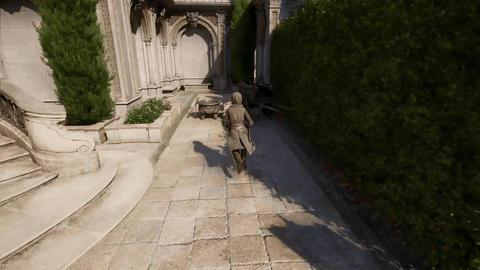
  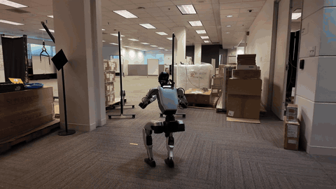
</div>

MotionBricks is a real-time generative framework that transforms interactive motion control for animation and robotics. It combines a large-scale latent backbone with intuitive "smart primitives" to deliver high-quality, zero-shot motion synthesis at 15,000 FPS — complementing the tracking-based GEAR-SONIC controllers in this repo.

This preview release ships an interactive G1 demo (keyboard-driven, MuJoCo viewer), pretrained checkpoints (VQVAE · pose · root), a synthetic training pipeline, and motion-representation docs. Its pretrained checkpoints are opt-in for monorepo clones; run `git lfs pull --include="motionbricks/out/**" --exclude=""` from the repo root before using the demo. A full release — fully embedded in the GEAR-SONIC pipeline — is targeted for approximately one month out. See [`motionbricks/README.md`](motionbricks/README.md) for setup, demo, and training instructions.

## Decoupled WBC

For the Decoupled WBC used in GR00T N1.5 and N1.6 models, please refer to the [Decoupled WBC documentation](docs/source/references/decoupled_wbc.md).


## Acknowledgments
We would like to acknowledge the following projects from which parts of the code in this repo are derived from:
- [Beyond Mimic](https://github.com/HybridRobotics/whole_body_tracking)
- [Isaac Lab](https://github.com/isaac-sim/IsaacLab)
