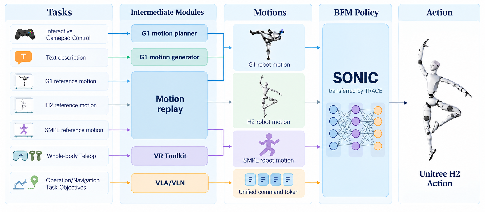

# SONIC_unitree_h2

[](https://bfm-trace.github.io/)
[](https://arxiv.org/abs/2610.17999)
[](https://bfm-trace.github.io/demo/index.html)
[](README.md)

论文 [TRACE: Efficient Transfer Learning for Neural Whole-Body Control Across Humanoid Embodiments](https://arxiv.org/abs/2610.17999) 的 Unitree H2 部署官方实现。

## 项目概览



基于 TRACE，本项目以较低的额外训练成本将 SONIC 预训练全身控制策略迁移至 Unitree H2。部署框架提供统一的多本体参考动作与多模态指令接口，支持 G1、H2 和 SMPL 动作回放、运动规划、离线文本动作生成及 VR 遥操作，并预留直接 token 输入接口，以便后续接入 VLA/VLN。

## 工作流

| 工作流 | 功能 | 使用指南 |
|---|---|---|
| Sim2Sim | MuJoCo 仿真与 C++ 控制器通过 DDS 通信 | [仿真运行](docs/DEPLOYMENT_CN.md#sim2sim) |
| Sim2Real | Unitree H2 实机全身动作跟踪 | [实机部署](docs/DEPLOYMENT_CN.md#sim2real) |
| Text-to-motion | 使用 ECHO-G 离线生成语音与 G1 手势，通过 motion replay 展示 | [语音与动作生成](docs/TEXT2MOTION_CN.md) |
| VR 遥操作 | 基于 PICO 与 XRoboToolkit 的头部、双手三点遥操作 | [遥操作](docs/DEPLOYMENT_CN.md#vr-遥操作) |

源码分为 [`src/runtime/`](src/runtime/README.md)（C++ policy）、[`src/interface/`](src/interface/README.md)（Python 上游推理与指令发送）、[`src/sim/`](src/sim/README.md)（仿真器）。离线生成、资源准备和验证工具按用途放在 [`tools/`](tools/README.md)。

## 快速开始

runtime 完成站姿初始化后，等待按 **]** 或 **s** 开启 policy，再接收独立 motion replay、planner 和遥操作进程的指令；按 **o** 进入阻尼并停止。仿真与实机共用同一 runtime；头部 pitch/yaw 和灵巧手分别使用独立通道。输入端与 planner 统一使用 Python，实时 policy runtime 使用 C++，policy 与 planner 推理使用 TensorRT。可选的 ECHO-G 生成器离线生成语音和 G1 手势，再通过 motion replay 展示。

```bash
git clone --depth 1 --recurse-submodules https://github.com/QinnyuLan/SONIC_unitree_h2.git
cd SONIC_unitree_h2
python3 tools/validation/verify_release.py
```

按照[部署指南](docs/DEPLOYMENT_CN.md)安装依赖、编译控制器并运行仿真。H2 模型位于 [`models/sonic_h2_released/`](models/sonic_h2_released/)，需要行走规划时，可另行下载并运行 [SONIC planner](docs/DEPLOYMENT_CN.md#planner)。

[中英文 H2 自我介绍 demo](docs/TEXT2MOTION_CN.md#直接展示已有示例)已包含语音和 ECHO-G 动作，可直接通过 motion replay 播放，无需配置 ECHO-G 或下载生成模型。

## 文档

- [架构与指令协议](docs/ARCHITECTURE_CN.md)：独立 runtime、稀疏参考、头部和手部通道。
- [工程结构](docs/LAYOUT.md)：C++ runtime、Python 服务、模型、配置与动作示例。
- [安装与部署](docs/DEPLOYMENT_CN.md)：环境配置、Sim2Sim、Sim2Real 和 VR 遥操作。
- [离线 text2motion](docs/TEXT2MOTION_CN.md)：中英文语音、G1 手势生成及音频回放。
- [机器人端手部服务](docs/INSPIRE_HANDS_CN.md)：Inspire DDS/RS-485 部署、开机自启动与看门狗。
- [发布模型说明](models/sonic_h2_released/README.md)：输入输出接口与文件校验。
- [复现记录](docs/REPRODUCIBILITY.md)：模型验证、推理检查与测试结果。
- [文档索引](docs/README.md)：配置、故障排查与开发说明。

## 引用

如果本项目对您的研究有帮助，请引用：

```bibtex
@misc{lan2026traceefficienttransferlearning,
  title={TRACE: Efficient Transfer Learning for Neural Whole-Body Control Across Humanoid Embodiments},
  author={Qingyu Lan and Zhihao Tian and Zifan Wang and Junwei Liang},
  year={2026},
  eprint={2610.17999},
  archivePrefix={arXiv},
  primaryClass={cs.RO},
  url={https://arxiv.org/abs/2610.17999},
}
```

引用元数据同时提供于 [`CITATION.cff`](CITATION.cff) 和 [`references.bib`](docs/references.bib)。

## 致谢

- [SONIC / GR00T Whole-Body Control](https://github.com/NVlabs/GR00T-WholeBodyControl)：预训练控制器、动作表征与部署框架。
- [ECHO-G](https://github.com/NJU-SOARLAB/ECHO-G)：语音驱动的 G1 手势生成。
- [MuJoCo](https://github.com/google-deepmind/mujoco)：物理仿真与可视化。
- [Unitree SDK2](https://github.com/unitreerobotics/unitree_sdk2)：机器人 DDS 通信。
- [DFX Inspire Service](https://github.com/unitreerobotics/dfx_inspire_service)：Inspire 灵巧手 DDS 服务与串口协议实现。
- [XRoboToolkit](https://github.com/XR-Robotics/XRoboToolkit-PC-Service)：PICO VR 设备与三点跟踪接口。

完整依赖与来源见[上游依赖与参考工作](docs/ACKNOWLEDGMENTS.md)。

## 许可证

除另有说明的组件外，源代码采用 Apache-2.0 许可证。模型权重和第三方组件遵循各自的许可条款，详见 [LICENSE](LICENSE) 与[许可证及声明](licenses/README.md)。
