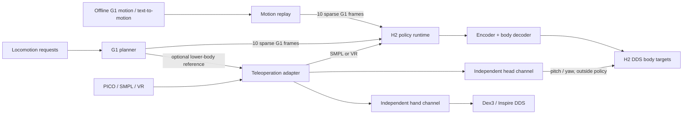

# Runtime and Command Protocol

[Deployment](DEPLOYMENT.md) · [中文](ARCHITECTURE_CN.md)

## Process boundaries



`src/runtime/` owns the complete C++ execution path: standing, reference sampling, encoder/decoder inference, command arbitration and H2 output. Its headers, TensorRT wrapper, Unitree SDK and build configuration are contained in this directory. The executable has no planner, motion-file reader, PICO device code or text-generation model. Motion readers and kinematics used by regression tests are isolated under `src/runtime/tests/`.

`src/interface/` contains Python producers and the planner service. `src/interface/planner/` implements context preparation, resampling and trajectory blending in NumPy. `src/interface/planner/engine.py` calls the TensorRT Python API directly. Models live under `models/`, replay examples under `motions/`, and deployment settings under `config/`. `src/sim/` contains the independent MuJoCo simulator and DDS bridge. Shared robot resources live under `assets/`. See the [repository layout](LAYOUT.md).

| Component | Language | Model execution |
|---|---|---|
| Replay, planner requests, teleoperation, head/hands | Python | None |
| G1 planner service | Python | TensorRT Python API + CUDA bindings |
| H2 policy runtime | C++ | TensorRT C++ API + CUDA graphs |

Deployment uses TensorRT exclusively. The release manifest binds recorded model interfaces and metadata to ONNX SHA256 hashes; the runtime verifies those hashes before loading models. TensorRT checks the actual tensor interfaces. ONNX Runtime is used only by the optional offline model-comparison tool.

Python and C++ use the same engine-cache format and FP32 build policy (TensorRT's default TF32 allowance, no FP16). Cache compatibility includes model SHA256, GPU name, precision and TensorRT version. A missing or incompatible cache is rebuilt on the local GPU.

Startup interpolates from measured joints to the default pose over three seconds. The body policy then runs at 50 Hz; DDS targets publish at 500 Hz. A missing or expired body command selects the standing reference. Robot-state loss, invalid model output, explicit stop or control-thread timeout ends control with damping. The head and hands have their own command ownership and expiry. Stop is latched until the runtime restarts.

## Transport

All new messages are single-frame UTF-8 JSON over ZeroMQ. The runtime binds input sockets; producers connect. Defaults bind loopback. Change the bind endpoints explicitly for other hosts; wall clocks must be synchronized.

| Endpoint | Socket at service | Purpose |
|---|---|---|
| `tcp://127.0.0.1:5558` | Runtime PULL | Body: `g1`, `smpl`, `vr`, `token`, `stand`, `stop` |
| `tcp://127.0.0.1:5559` | Runtime PUB | State, schema `sonic.h2.state.v1` |
| `tcp://127.0.0.1:5560` | Planner PULL | Locomotion requests: `planner`, `stand` |
| `tcp://127.0.0.1:5561` | Planner PUB | Sparse G1 reference envelopes |
| `tcp://127.0.0.1:5562` | Runtime PULL | Head: `head`, `stand` |
| `tcp://127.0.0.1:5563` | Runtime PULL | Hands: `hands`, `stand` |
| `tcp://127.0.0.1:5556` | PICO PUB | Existing binary tracking packets, consumed only by the adapter |

Command envelope:

```json
{
  "schema": "sonic.h2.command.v1",
  "kind": "head",
  "source": "head_controller",
  "session": "unique-id-per-producer-start",
  "seq": 1,
  "sent_at_ms": 1791936000000,
  "ttl_ms": 250,
  "takeover": false,
  "data": {"pitch": 0.3, "yaw": -0.2}
}
```

Use the current Unix time in milliseconds. `seq` increases within each session. TTL is an integer from 50 to 1000 ms, default 250; transport delay counts against it. More than 250 ms of apparent future clock skew is rejected. Input shapes, finite numbers and quaternion norms are validated before acceptance.

The first producer owns its channel until expiry or `stand`. Another producer needs explicit `takeover: true` to replace it. A superseded producer's shutdown cannot clear the current owner's command. `stop` can always stop the body runtime. Each channel has an independent owner: head commands do not acquire or release the body channel. PUB/PUSH transport provides no execution acknowledgment; inspect runtime state to confirm the active source. The Python client returns whether a message was queued locally.

## Body data

| Kind | Fields | Timing / frame |
|---|---|---|
| `g1` | `joint_pos[10,29]`, `joint_vel[10,29]`, `root_quat[10,4]` | Future offsets 0.0–0.9 s at 0.1 s intervals |
| `vr` | `positions[3,3]`, `orientations[3,4]`, `lower_body` with the G1 fields above | Left wrist, right wrist, head; calibrated robot-local coordinates |
| `smpl` | `joints[10,24,3]`, `root_quat[10,4]`, `wrist_joints[10,6]` | Future offsets 0.00–0.18 s at 0.02 s intervals |
| `token` | `tokens[64]` | Direct decoder latent input; encoder bypassed while fresh |
| `stand`, `stop` | Empty object | Release to standing / end control with damping |

Angles are radians; velocities rad/s; positions meters; all quaternions **wxyz**. G1 angles are absolute, with no H2 projection applied by the runtime. SMPL joints are root-centered vectors expressed in world axes; the runtime rotates them into the SMPL root frame. SMPL wrists follow `[left_roll, right_roll, left_pitch, right_pitch, left_yaw, right_yaw]`.

References advance according to packet time. Position/velocity interpolation is linear; quaternion interpolation uses SLERP. Sampling beyond a packet's reference horizon holds its final sample until expiry. Replay sets terminal velocities to zero. Heading is aligned once when the source/session or body kind changes, then remains fixed across packets so turns are preserved.

The full encoder layout remains 1751 → 64: selector 0 for native H2 standing, 1 for VR, 2 for SMPL, 3 for native G1. The decoder remains 994 → 29 and receives ten history frames in oldest-to-newest order. The interface reserves direct token input; no VLA model, GR00T integration or associated dependencies are included.

## Head and hands

Head data is `{"pitch": number, "yaw": number}`. It controls only H2 DDS joints 29 and 30, after body inference. Pitch is clamped to `[-0.5236, 0.83775]`, yaw to `[-1.7453, 1.7453]`, and target velocity to 2 rad/s. Expiry returns the target to neutral with the same velocity limit.

Hand data contains `left` and/or `right`, each a seven-value Dex3-compatible target. Missing sides do not reuse a previous command. Expiry stops hand publishing. Inspire converts targets to closure and retains its release-before-close input gate. Use the backend's measured state to interpret actual finger position; the runtime's `hands_active` flag reports command freshness.

```python
from interface.commands import RuntimeClient

with RuntimeClient("head_demo", "tcp://127.0.0.1:5562") as client:
    client.send("head", {"pitch": 0.3, "yaw": 0.0})
    # Refresh at 20–50 Hz while the target should remain active.
```

`RuntimeClient` validates the payload and creates the timestamp, session and sequence. Leaving its context releases that channel; the TTL also covers an ungraceful producer exit.

## Joint order

Native G1 semantic order, matching SONIC CSV `joint_pos` and sparse planner output:

```text
0 left_hip_pitch       1 right_hip_pitch       2 waist_yaw
3 left_hip_roll        4 right_hip_roll        5 waist_roll
6 left_hip_yaw         7 right_hip_yaw         8 waist_pitch
9 left_knee           10 right_knee          11 left_shoulder_pitch
12 right_shoulder_pitch  13 left_ankle_pitch  14 right_ankle_pitch
15 left_shoulder_roll 16 right_shoulder_roll 17 left_ankle_roll
18 right_ankle_roll   19 left_shoulder_yaw    20 right_shoulder_yaw
21 left_elbow         22 right_elbow         23 left_wrist_roll
24 right_wrist_roll   25 left_wrist_pitch     26 right_wrist_pitch
27 left_wrist_yaw     28 right_wrist_yaw
```

Runtime feedback `joint_pos[31]` and `joint_vel[31]` use H2 DDS order: left leg (6), right leg (6), waist yaw/roll/pitch (3), left arm (7), right arm (7), head pitch/yaw (2). H2 leg order is hip pitch/roll/yaw, knee, ankle roll/pitch. This differs from G1 MuJoCo order. Native mappings are defined in `policy_parameters.hpp` and tested with the released model contract.
