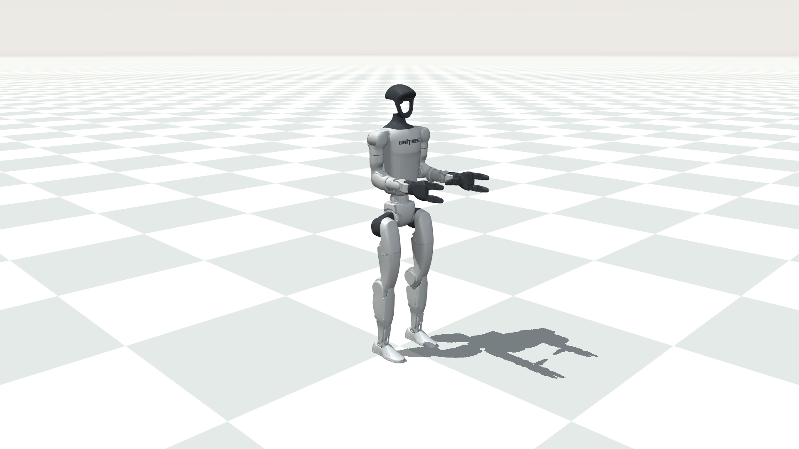

# G1 预训练 SONIC：论文展示风格

G1 使用与 H2 相同的 `paper` 天空、地面和光照，镜头按 G1 身高调整为
距离 3.2 m、观察中心高度 0.65 m。修改
[启动脚本](../../scripts/run_g1_paper_sim.sh) 开头的参数可以调整构图；
`CAMERA_MODE=follow` 为跟随镜头，`fixed` 为固定镜头。



关闭旧仿真和旧控制器后，终端 1：

```bash
bash /home/qingyul/workspace/SONIC-H2/scripts/run_g1_paper_sim.sh
```

终端 2，加载 G1 预训练 SONIC 和探索动作集：

```bash
cd /home/qingyul/workspace/SONIC-H2/gear_sonic_deploy
source scripts/setup_env.sh
export GEAR_SONIC_DOMAIN_ID=0
unset GEAR_SONIC_INITIAL_MOTION_NAME GEAR_SONIC_SKIP_MOTION_SWITCHER
unset GEAR_SONIC_AUTO_START_AFTER_SEC GEAR_SONIC_AUTO_PLAY_AFTER_SEC
unset GEAR_SONIC_AUTO_NEXT_AFTER_SEC GEAR_SONIC_AUTO_STOP_AFTER_SEC

./deploy.sh \
  --robot-profile g1 \
  --encoder-file policy/release/model_encoder.onnx \
  --decoder-file policy/release/model_decoder.onnx \
  --obs-config policy/release/observation_config.yaml \
  --motion-data reference/example_g1_explore \
  --no-planner --input-type keyboard --output-type zmq \
  --hand-backend none sim
```

操作：`y` → 初始化完成 → `]` → 仿真窗口 `9` 解除支撑 → 控制端 `t` 播放。
`n/p` 切换动作，`r` 重置，`o` 停止。

录屏仍使用桌面录屏工具，建议窗口 16:9、1080p、50 fps。
跳跃和大范围移动可以增大镜头距离到 5～6 m，或者使用跟随模式。

已验证 G1 与 H2 原版/展示版各 30 类物理数组一致，同输入下 250 个物理步的
qpos/qvel 逐位一致。G1 原有步长 5 ms、H2 原有步长 1 ms 均保留。
G1 1080p EGL 渲染通过，桌面录屏性能尚未验证。

G1 使用 include 加载本体，展示模式在临时 MJCF 中展开 include 并修正资源
路径；原始模型文件不变。质心和传感器标记仅设置透明，不移除站点或传感器。

重新生成静态外观预览（不执行策略）：

```bash
cd /home/qingyul/workspace/SONIC-H2
MUJOCO_GL=egl .venv_sim/bin/python scripts/preview_h2_paper_scene.py \
  --robot g1 --output test_logs/g1_paper_preview/paper.png
```
