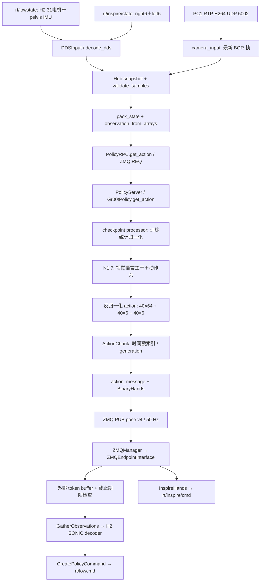

# H2 N1.7 + SONIC 真机测试：启动、调用链与接口

部署工程：`/home/qingyul/workspace/SONIC-H2`，主机 m21。
本适配使用 2026-09-19 的 H2 遥操作后训练模型。交付版本见
`models/h2_n1d7/latest/deployment_manifest.json` 的 `training_step`；`latest` 是完整校验后的版本链接。
本文中的相对路径均相对于上述工程根目录。

## 1. 交付范围与文件位置

| 文件/目录 | 职责 |
| --- | --- |
| `gear_sonic_deploy/scripts/run_h2_vla.sh` | 统一入口：check/server/replay/deploy/shadow/live |
| `gear_sonic_deploy/config/h2_vla.env` | N1.7 地址、模型、SONIC 模型、站立参考和相机端口 |
| `gear_sonic/scripts/run_h2_n1d7_server.py` | 离线加载 BF16 模型并启动 PolicyServer |
| `gear_sonic/scripts/run_h2_vla_inference.py` | 原生 DDS/RTP 观测、异步推理、50 Hz 调度、人工启动、日志 |
| `gear_sonic/utils/inference/h2_vla.py` | 观测/动作契约、手部映射、动作期限、轻量 PolicyRPC |
| `gear_sonic/utils/inference/h2_vla_features.py` | 训练侧 `gr00t/data/h2_sonic.py` 的原样副本 |
| `gear_sonic_deploy/src/g1/g1_deploy_onnx_ref/include/h2_vla_watchdog.hpp` | C++ 接收端数值与期限检查 |
| `gear_sonic_deploy/scripts/check_h2_vla.sh` | Python 单测、实际 C++ ZMQ 接收链路测试，无 DDS |
| `third_party/isaac_gr00t_n1d7/gr00t/` | 本次训练工程的推理源码快照 |
| `models/h2_n1d7/checkpoint-*/` | 独立 BF16 推理 checkpoint、训练统计、manifest、校验文件、回放样本 |
| `models/h2_n1d7/backbone/` | 训练时实际使用的 backbone/tokenizer 本地缓存 |
| `.venv_n1d7/` | 独立 Python 3.12 / PyTorch 2.9 / Transformers 4.57.3 服务环境 |
| `.venv_data_collection/` | 现有 Python 3.10 客户端环境，提供 DDS 和 GStreamer |

原 `run_h2_teleop_head_adjust.sh`、`run_h2_sim2real_four_kp.sh` 和 `h2_deploy.env` 不改动。
VLA 启动器从 `h2_deploy.env` 读取现有网卡、DDS domain 和增益，再使用独立 VLA 配置选择模型。
共享 C++ 的新增行为仅在 `GEAR_SONIC_H2_VLA=1` 时启用；该变量由专用 deploy 入口设置。

## 2. 现场启动顺序

先恢复采集时的站位、玩具、纸箱和相机视角。关闭占用 5556 的 PICO/旧 VLA 发布器，
关闭占用 UDP 5002 的旧采集器/视频查看器。相机源的 RTP 发送服务保持运行。
本客户端独占相机接收端并自行保存推理图像；不能同时再开原采集器争用该端口。

首次可先运行完全不连接硬件的检查：

```bash
cd /home/qingyul/workspace/SONIC-H2
bash gear_sonic_deploy/scripts/check_h2_vla.sh
```

终端 A：模型服务。只启动推理，不启动机器人控制。

```bash
cd /home/qingyul/workspace/SONIC-H2
bash gear_sonic_deploy/scripts/run_h2_vla.sh server
```

等待 `Server ready`。在另一个终端运行回放联通/预热检查：

```bash
cd /home/qingyul/workspace/SONIC-H2
bash gear_sonic_deploy/scripts/run_h2_vla.sh replay --samples 12
```

`replay` 只使用包中的 12 个验证集采样帧，通过模型 RPC 检查输出和延迟，不订阅 DDS，
不绑定动作端口，不发布头部或手部指令。报告写到 `gear_sonic_deploy/logs/h2_vla_replay_*/report.json`。
首次推理含 GPU 预热；应查看后续 `steady_mean_s`、`steady_p95_s`。

终端 B：H2 SONIC 控制器，由现场人员按原部署程序的提示确认初始化。

```bash
cd /home/qingyul/workspace/SONIC-H2
bash gear_sonic_deploy/scripts/run_h2_vla.sh deploy
```

终端 C：客户端。首次可用 `shadow` 只观察模型预测，退出后再启动 `live`：

```bash
cd /home/qingyul/workspace/SONIC-H2
bash gear_sonic_deploy/scripts/run_h2_vla.sh shadow
# Ctrl+C 退出 shadow，再执行：
bash gear_sonic_deploy/scripts/run_h2_vla.sh live
```

`shadow` 不创建动作 PUB，不发送身体、手部或头部指令。它需要真实相机、lowstate 和手部反馈。
启动 `live` 后仍是 idle；等到状态有效、模型就绪，在终端 C 输入命令并回车：

| 命令 | 行为 |
| --- | --- |
| `stand` | 明确启动 SONIC 控制，使用专用 H2 站立参考；N1.7 持续推理但不发送 token |
| `run` | 检查控制器版本、反馈新鲜度、已有新鲜预测和实际头部角度，随后切入 VLA |
| `pause` | 停止发送 VLA token；接收端在最多约 250 ms 内清除外部 token 并回到站立参考 |
| `run`（再次） | 明确重新启用接收端；恢复后的预测必须来自新的客户端 generation |
| `quit` / Ctrl+C | 退出客户端；C++ 接收端独立回到站立参考，头部仍保持固定角度 |
| `stop` | 调用原 C++ stop 流程并结束控制程序；恢复需要重新启动 deploy |

日常暂停使用 `pause`。`stop` 会结束控制程序，不等同于保持站立。
`stand` 后由现场操作者确认稳定站立，再输入 `run`。保留现场人工接管和原急停操作。
此交付没有执行真机动作，也没有验证站立切换过程中的实体动力学。

`--print-command` 可查看每个入口将执行的命令，不启动对应程序，例如：

```bash
bash gear_sonic_deploy/scripts/run_h2_vla.sh deploy --print-command
```

## 3. 实际调用链



模型服务器只负责推理，不读写机器人 DDS。客户端和 C++ 接收器必须在同一台 Linux 主机，
动作包的期限使用同一个 `CLOCK_MONOTONIC` 时间基准。模型服务器可以另放 GPU 主机，
但客户端仍应放在 m21，且网络推理耗时计入动作年龄。

服务端完整加载 exported checkpoint；`../backbone` 只是构建模型及 tokenizer 所需的本地缓存，
完整 GR00T checkpoint 覆盖其模型参数。当前实际缓存与训练一致；未声称已经验证它与官方
Cosmos tokenizer 的逐文件一致性。迁移时要同时带上 `backbone` 和推理源码/依赖。

## 4. 观测接口

`PolicyServer.get_action` 输入为嵌套字典，B=1、观测历史 T=1：

| 键 | 形状/类型 | 来源与约定 |
| --- | --- | --- |
| `video.ego_view` | `[1,1,360,640,3]` uint8 | 同路头部图像，BGR→RGB，保留完整视野后缩放 |
| `state.left_leg`、`state.right_leg` | 各 `[1,1,6]` float32 | 原生关节弧度，踝 pitch 槽在 roll 之前 |
| `state.waist` | `[1,1,3]` | yaw、roll、pitch |
| `state.left_arm`、`state.right_arm` | 各 `[1,1,7]` | shoulder pitch/roll/yaw、elbow、wrist roll/pitch/yaw |
| `state.left_hand`、`state.right_hand` | 各 `[1,1,6]` | 实测 pinky、ring、middle、index、thumb_bend、thumb_rotate |
| `state.projected_gravity` | `[1,1,3]` | pelvis IMU wxyz，世界向下向量投影到 pelvis 坐标系 |
| `language.annotation.human.task_description` | `[[字符串]]` | 固定为训练指令 |

总状态 44 维：29 身体 + 12 手部 + 3 重力。头 pitch/yaw 从模型状态中去除。
`decode_dds` 已将 Inspire DDS 的 right/left 调换成 left/right，后续不再次交换。
不能使用旧 G1 robot_model 转换后的 debug body_q 代替原生 lowstate。
`g1_debug` 在客户端仅用于控制器在线性检查，不作为 N1.7 身体状态输入。

语言：`Pick up the orange plush toy with your left hand and place it in the cardboard box.`

相机有效更新频率约 15 Hz，模型/控制时间轴 50 Hz；每次推理读取最新收到的画面。
实况使用 OpenCV AREA 缩放；训练转换视频使用 PyAV 重编码缩放，因此像素不逐点相同，
但采用相同视野、RGB 顺序和 640×360 几何尺寸。随后由保存的 processor 完成训练对应的处理。
相机时间为接收时间，本系统不宣称曝光级同步。

新鲜度限制：lowstate 100 ms、Inspire 300 ms、camera 350 ms、控制器 debug 150 ms。
首次 `stand` 前只要求前三项和有效 `robot_config`；C++ 在开始控制后才发布 debug，
所以不能将 debug 作为初次站立的前置条件。`stand` 后以及所有 `run` 均检查 debug 新鲜度。
另外检查 lowstate CRC、手部 lost 标志、motorstate 错误和数值有限性。

## 5. 动作和传输接口

模型输出是原始单位的绝对动作，不再次归一化：

| 模型动作键 | 形状 | 语义 |
| --- | --- | --- |
| `motion_token` | `[1,40,64]` | SONIC 已对齐的 latent token |
| `left_hand_joints` | `[1,40,6]` | Inspire：0 闭合、1 张开 |
| `right_hand_joints` | `[1,40,6]` | 同上；本批数据右手恒张开 |

客户端使用返回 tuple 的 action 部分，不把 info 当动作。形状、NaN/Inf 和界面范围错误直接拒绝。
SONIC decoder 使用采集模型 `gpu3_20260909_stage2_step005000`，输入为 64 token + 930 维
控制器自行维护的 proprio/history，输出 29 维 H2 身体动作。N1.7 的 44 维观测不用于拼接这 930 维。
外部 token 存在时跳过 encoder；暂停后重新启用站立参考对应的 encoder。
该 SONIC 模型的方向契约为 `sonic_full_root_relative_v0`，H2 适配已经折叠在 ONNX 内，
不再外加 G1→H2 轴变换，也不切换为 v1.1 robot-heading 契约。
头部独立保持 pitch=40°、yaw=0°，不在 29 维 decoder 输出或 76 维 VLA 动作中。

动作 ZMQ 地址固定为本机 `127.0.0.1:5556`，单帧格式：

```text
"pose" + 1280-byte NUL-padded JSON header + little-endian binary fields
header.v = 4
token_state                 f32 [1,64]
frame_index                 i64 [1]
left_hand_joints             f32 [1,7]  # 协议适配后的参考值
right_hand_joints            f32 [1,7]
h2_vla_deadline_monotonic    f64 [1]    # 观测/请求起点 + 0.8秒
```

当前 C++ 手部协议接收 7 维。客户端对每手 6 维预测求平均，≤0.35 闭合、≥0.65 张开，
中间区间保持原目标，形成滞回；初始目标由实测手部位置确定。
开合目标映射到现有左右 Dex3 closed reference 的 0/1 倍，
`InspireHands::ClosureFromDex3Target` 再解回闭合比例。
这仅是传输适配；模型输入/输出始终是实际的 6 维 Inspire 约定。
现有 Inspire 后端维持 20 Hz 发布、单次位置变化≤0.2，并继续检查实测反馈是否在线。
离线手部指标评估的是模型原始 6 维预测；现场的二值化和已有平滑会影响切换时机，
首次任务测试要重点核对抓取闭合和入箱松手时刻。

头部 topic 为 `head_pose`，包含 `head_pitch_yaw` f32[2]，顺序 pitch、yaw，单位弧度。
控制器在专用 VLA 模式下还会固定这两个目标，因此 Python 退出或头部心跳过期后不会回到 0°。

## 6. 时序、暂停与故障行为

- N1.7 每 0.4 秒触发一次异步推理，一次最多一个请求在途。
- 40 步动作对应 0.8 秒，50 Hz 执行。索引按当前时间减观测/请求时间计算，跳过已过期部分。
- 动作耗尽后不重复第 40 帧；进入 hold。
- 每次 stand/run/pause/fault 都更新 generation；切换前在途请求的旧结果不能重新接管。
- 客户端检测输入过期、推理错误、动作过期或发布间隔超过 200 ms 后停止 token 发布。
- 服务未就绪或重启后会重试连接并重新检查模型身份，但不会自动恢复 live 执行。
- C++ 仅用已接受 token 的时间戳计时；头部心跳不能刷新身体动作时效。
- C++ 检测 250 ms 无新 token，或到达该 chunk 的绝对截止时间后，清除 token/手部输入，
  关闭 streaming，切回专用站立参考第 0 帧，重新使用 encoder。恢复需要显式 `run`。
- 无效或过期 token 包同样触发回退；接收端使用位检查判断 NaN/Inf，兼容项目的 `-ffast-math`。
- 固定站立参考为 `reference/h2_default_stand_only/h2_default_stand`，不使用 G1 初始 token，
  不将 token 清零当作站立命令。回退链路的控制逻辑已做协议测试，实体站立稳定性仍需现场确认。

客户端 live 会校验 `robot_config`：h2_native、VLA protocol=1、watchdog 开启、指定 decoder、
站立参考、头部控制标记。不符合则拒绝 stand/run。
服务器还提供 `h2_deployment_info`，用于校验 44/76 维、40 步、50 Hz、SONIC SHA 与头部角度。

## 7. 日志与故障定位

客户端日志在 `gear_sonic_deploy/logs/h2_vla_<mode>_<time>/`：

- `run_config.json`：本次命令行参数。
- `model_manifest.json`：本次实际加载的模型版本，避免 latest 更新后混淆。
- `events.jsonl`：状态、拒绝原因、推理延迟、每帧 token/手部目标/索引/动作年龄。
- `chunk_*.npz`：每次推理的图像、44 维状态、整段动作与观测时间。
- replay 模式另有 `report.json` 和 `replay_*.npz`。

C++ CSV 写到 `gear_sonic_deploy/logs/h2_vla_controller_<time>/`，保留原控制器日志格式。
完成任务后记录实际成功/失败、操作者介入点；当前数据的 saved 标签不等于任务成功。

| 现象 | 优先检查 |
| --- | --- |
| 5556 绑定失败 | 旧 PICO/旧 VLA 发布器仍在运行 |
| UDP 5002 占用或没有画面 | 旧查看器/采集器争用、PC1 RTP 发送目的地址 |
| `watchdog` 配置不匹配 | 使用了旧二进制或旧部署入口，重新编译后启动专用 deploy |
| 模型找不到 backbone | 版本目录旁需有共享 `backbone`，用专用 server 启动 |
| run 被头部检查拒绝 | 等待头部到达 40°/0°，检查头部驱动反馈 |
| 首次预测超过 0.8 秒 | 先 replay 预热；run 需要已有新鲜预测 |
| 经常 hold | 查看事件中的观测年龄、RPC 延迟、动作期限、发布间隔 |
| 手开合反向/左右反向 | 对照 raw DDS right/left→数据集 left/right 的唯一交换位置及 0闭/1开约定 |

## 8. 模型导出与更新

训练端导出脚本：`/home/qingyul/workspace/Isaac-GR00T/examples/H2/export_deployment.py`。
导出保留完整 N1.7 参数，浮点权重转换为推理时使用的 BF16，逐张量核对与原 checkpoint
执行 `.to(torch.bfloat16)` 后数值完全一致。此包是 PyTorch/safetensors，不需要 TensorRT engine。
模型权重约 6.29 GB；额外携带 tokenizer/backbone 缓存及训练统计，省去 optimizer/scheduler。

```bash
# 在训练机执行，指定一个 trainer_state.json 已写完的 checkpoint：
cd /home/qingyul/workspace/Isaac-GR00T
OMP_NUM_THREADS=4 .venv/bin/python examples/H2/export_deployment.py \
  --checkpoint outputs/h2_sonic_n1d7_20260919_run1/checkpoint-10000 \
  --output-root outputs/h2_deployment_m21_20260919/models
```

先传入新的不可变版本目录，核对 `CHECKSUMS.sha256`，再替换 `latest` 链接。
服务器需要重启才会加载新版本；正在运行的服务不会因链接改变而自动换模型。
共享 backbone 需与训练一致，不自动联网下载替代模型。

## 9. 构建、检查和回滚

新增推理环境可用 `bash install_scripts/install_h2_n1d7_server.sh` 重建。
当前主要版本为 Python 3.12、torch 2.9.0+cu128、transformers 4.57.3；完整安装记录随交付保存。
服务在 m21 使用 PyTorch SDPA，已做实际输入推理检查；不依赖 flash-attn。

```bash
cd /home/qingyul/workspace/SONIC-H2
cmake --build gear_sonic_deploy/build --target g1_deploy_onnx_ref -j 4
bash gear_sonic_deploy/scripts/check_h2_vla.sh
```

原先已经存在的修改没有被 git reset/checkout。改动前的三个 C++ 文件以及已有 git diff 备份在
`gear_sonic_deploy/backups/h2_vla_20260919/`，Python适配、独立启动器和配置是新增文件。
正常返回遥操作时退出专用 VLA 客户端与控制器，使用原来的遥操作启动入口；该入口不设置
`GEAR_SONIC_H2_VLA=1`。若在 shell 中手动设置过此变量，先 `unset GEAR_SONIC_H2_VLA`。
需要源码回滚时仅恢复备份中的对应三个 C++ 文件并重新编译；不要覆盖后来另行修改的文件。

交付验证包括导出/传输校验、真实观测的模型 RPC、Python 契约测试、实际 C++ 接收器的
token/手部解码、心跳不掩盖超时、回退锁定、显式恢复以及 NaN/过期拒绝。
不包括真实机器人动作、完整 sim2sim 任务闭环、实体回退稳定性或抓取成功率验证。
