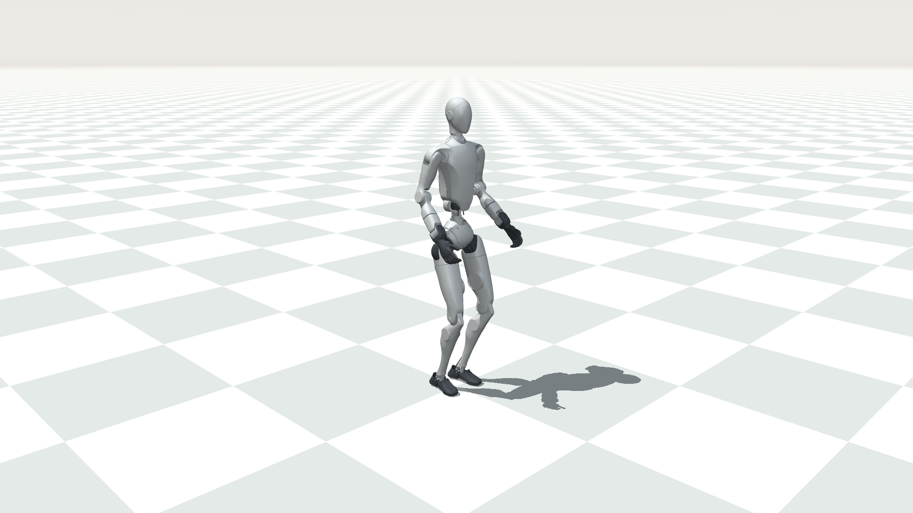

# H2 论文 / 演示录屏展示模式

G1 本体配合预训练 SONIC 的相同风格入口见 [G1 展示模式](g1_paper_sim2sim.md)。

`paper` 是 H2 官方闭环模型的可选外观模式：暖灰白天空、低饱和浅灰棋盘、
银灰不透明外壳、深灰手脚、双光源和地面阴影。默认采用固定世界镜头，便于
比较不同策略的位移、跳跃高度和动作完成情况。



上图是实际 MuJoCo 场景在初始化姿态下的 1920×1080 离屏渲染，仅展示外观。
策略控制及动作跟踪仍由独立的 H2 deploy 进程完成。

## 启动仿真

先关闭正在运行的旧仿真和控制端，在终端 1 执行：

```bash
bash /home/qingyul/workspace/SONIC-H2/scripts/run_h2_paper_sim.sh
```

可以直接修改 [启动脚本](../../scripts/run_h2_paper_sim.sh) 开头的参数：

| 参数 | 默认值 | 用途 |
| --- | --- | --- |
| `CAMERA_MODE` | `fixed` | 固定镜头；改为 `follow` 可跟随机器人 |
| `CAMERA_DISTANCE` | `4.5` | 镜头距离（米），跳跃/大幅位移动作可增大到 6～8 |
| `CAMERA_AZIMUTH` | `135` | 水平观察角度 |
| `CAMERA_ELEVATION` | `-15` | 俯视角度，越负越俯视 |
| `LOOKAT_X/Y/Z` | `0 / 0 / 0.85` | 固定镜头对准的位置 |
| `DDS_DOMAIN` | `0` | 与控制端一致 |

模式也可以直接用于原有命令：

```bash
cd /home/qingyul/workspace/SONIC-H2
.venv_sim/bin/python gear_sonic/scripts/run_sim_loop.py \
  --wbc-version h2_native_unitree_ros_loop --interface sim \
  --visual-style paper --presentation-camera fixed \
  --presentation-distance 4.5 --presentation-azimuth 135 \
  --presentation-elevation -15 --presentation-lookat 0 0 0.85
```

不传 `--visual-style paper` 时仍使用原场景。界面支持 MuJoCo 原有鼠标旋转、
平移、缩放操作；录制比较视频前应统一构图，固定镜头不会自动把走出画面的
机器人移回中央。`follow` 会跟随身体运动，适合大范围移动的演示。

## H2 控制端示例

2026-09-18 起当前模型已更新到 stage2 step 70000；优先使用
[配置与启动脚本](h2_stage2_70000_deployment.md)。下方保留 step 9450 的历史示例。

终端 2，使用当前 gpu3 stage2 step 9450 临时模型和 H2 动作集合：

```bash
cd /home/qingyul/workspace/SONIC-H2/gear_sonic_deploy
source scripts/setup_env.sh
export GEAR_SONIC_DOMAIN_ID=0
unset GEAR_SONIC_INITIAL_MOTION_NAME GEAR_SONIC_SKIP_MOTION_SWITCHER
unset GEAR_SONIC_AUTO_START_AFTER_SEC GEAR_SONIC_AUTO_PLAY_AFTER_SEC
unset GEAR_SONIC_AUTO_NEXT_AFTER_SEC GEAR_SONIC_AUTO_STOP_AFTER_SEC

MODEL=../sonic_h2_native_release/experiments/gpu3_20260907_stage2_step009450
./deploy.sh \
  --robot-profile h2_native \
  --encoder-file "$MODEL/model_encoder_full.onnx" \
  --decoder-file "$MODEL/model_decoder.onnx" \
  --obs-config policy/release/observation_config_h2_native.yaml \
  --motion-data reference/example_h2/deploy \
  --no-planner --input-type keyboard --output-type zmq \
  --hand-backend none sim
```

操作：`y` → 等待 `Init Done` → `]` 启动策略 → 仿真窗口 `9` 解除弹性支撑
→ 稳定后控制端 `t` 播放。`n/p` 切换动作，`r` 重置，`o` 退出控制。

## 录屏与论文用图

- 将仿真窗口调整到 16:9，录制时只采集仿真窗口。脚本运行的是实时仿真，
  本身不自动保存视频。界面面板默认关闭。
- 推荐 1920×1080、50 fps，以匹配当前 50 Hz 画面更新。录屏工具设为 60 fps
  也可以，但不会增加仿真的独立画面数量。
- 在解除弹性支撑后录制正式动作。对比实验固定相同镜头和视角，时间标注
  使用仿真时间；美化不意味着改变运行速度或对动作进行平滑。
- 若机器在高分辨率录屏时出现实时超时，应减小窗口或降低录屏负载。
  仿真原有超时检查仍生效，物理步长保持 1 ms。
- 单独生成 1080p 场景预览（无 DDS、无策略控制）：

```bash
cd /home/qingyul/workspace/SONIC-H2
MUJOCO_GL=egl .venv_sim/bin/python scripts/preview_h2_paper_scene.py \
  --output test_logs/h2_paper_preview/paper.png
```

## 验证

2026-09-09：原版与展示模式的 29 类物理数组完全一致，包括碰撞几何、质量、
惯量、关节、闭环约束、摩擦、驱动范围；同输入下 250 个物理步的 qpos/qvel
逐位一致。固定/跟随镜头检查、7 项现有实时调度测试以及 1080p EGL 渲染通过。
独立 loopback DDS domain 74 的无界面启动检查完成 4,430 个物理步，实时倍率
0.999986，最大延迟 0.76 ms，正常退出。
当前无桌面 DISPLAY，交互窗口和桌面录屏性能需在实际录屏桌面上确认。

外观调整只写入临时 MJCF；原始 H2 XML 和 release 模型不变。隐藏碰撞形状和
调试点仅改变其透明度，物理碰撞仍然参与计算。
